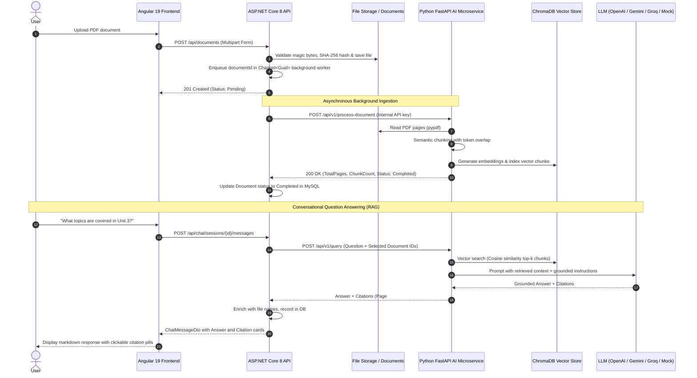

# DocuMind AI — Intelligent Document Assistant & RAG Platform

> A production-ready, full-stack AI document question-answering platform built with **Angular 19**, **ASP.NET Core 8**, **Python FastAPI**, **ChromaDB**, and **MySQL**.

[](frontend)
[](backend)
[](ai_service)
[](ai_service)
[](docker-compose.yml)

---

## 1. Project Overview & Workflow

**DocuMind AI** allows users to upload documents (such as university syllabi, lecture notes, textbook chapters, legal contracts, or technical manuals), index them with semantic vector search, and ask questions in natural language.

The application answers queries using **Retrieval-Augmented Generation (RAG)**, providing **exact page citations and verified snippet excerpts** so students and professionals can verify every claim.

### End-to-End Workflow



---

## 2. System Architecture

DocuMind AI is architected with clear separation of concerns across 4 tiers:

```
┌────────────────────────────────────────────────────────────────────────┐
│                          Angular 19 Frontend                           │
│  - Standalone Components & Signals                                     │
│  - Dark/Light Theme with Glassmorphism Design System                   │
│  - Drag & Drop PDF Uploader with Real-time Progress                    │
│  - Real-time Polling for Processing Documents                          │
│  - Grounded Citation Cards with Modal Excerpt Inspector                │
└──────────────────────────────────┬─────────────────────────────────────┘
                                   │ HTTPS / REST (JWT Bearer Token)
                                   ▼
┌────────────────────────────────────────────────────────────────────────┐
│                        ASP.NET Core 8 Web API                          │
│  - ASP.NET Core Identity (Registration, Login, Lockout Protection)     │
│  - JWT Bearer Authentication & Claims-based Authorization              │
│  - System.Threading.Channels Asynchronous Ingestion Pipeline           │
│  - Microsoft.Extensions.Resilience (Polly Retry & Circuit Breakers)   │
│  - Rate Limiting (100 req/min global, 10 req/min for uploads)          │
│  - Secure Document Storage with SHA-256 Hashing & Magic Bytes Check    │
└──────────────────┬──────────────────────────────────┬──────────────────┘
                   │                                  │
    HTTP + Internal Key Header       EF Core 8 / Pomelo MySQL Provider
                   │                                  │
                   ▼                                  ▼
┌──────────────────────────────────────┐  ┌──────────────────────────────┐
│       Python FastAPI AI Service      │  │        MySQL Database        │
│  - Text Extraction (pypdf)           │  │  - Identity Tables (Users)   │
│  - Sliding Window Chunking           │  │  - Documents & Hash Table    │
│  - Vector Embeddings                 │  │  - Processing Jobs           │
│  - ChromaDB Semantic Search          │  │  - Chat Sessions & Messages  │
│  - Grounded RAG Generation           │  │  - JSON Citation Storage     │
└──────────────────┬───────────────────┘  └──────────────────────────────┘
                   │
                   ▼
┌──────────────────────────────────────┐
│     ChromaDB Persistent Vectors      │
│  - Cosine Distance Metric            │
│  - Document ID Partitioning / Filter │
└──────────────────────────────────────┘
```

---

## 3. Directory Layout

```
AI-Powered Document Assistant/
├── .env.example                  # Environment configuration template
├── .env                          # Local development variables (mock provider ready)
├── .gitignore                    # Comprehensive ignore file
├── docker-compose.yml            # Multi-container orchestration (MySQL, AI, API, Frontend)
├── README.md                     # This documentation
│
├── frontend/                     # Angular 19 SPA
│   ├── src/
│   │   ├── app/
│   │   │   ├── components/       # Reusable components (Toast, etc.)
│   │   │   ├── guards/           # authGuard protecting private routes
│   │   │   ├── interceptors/     # authInterceptor (JWT token & 401 handling)
│   │   │   ├── models/           # TypeScript interfaces (Auth, Docs, Chat)
│   │   │   ├── pages/
│   │   │   │   ├── dashboard/    # Split-view document manager & AI chat
│   │   │   │   ├── login/        # Glassmorphic login page with demo pre-fill
│   │   │   │   └── register/     # User registration with password policy
│   │   │   ├── services/         # AuthService, DocumentService, ChatService, ToastService
│   │   │   ├── app.config.ts     # Standalone bootstrap with HttpClient & Interceptors
│   │   │   └── app.routes.ts     # Client routing configuration
│   │   ├── environments/         # Dev and Prod environment configs
│   │   ├── index.html            # Google Fonts (Plus Jakarta Sans, Inter, JetBrains Mono)
│   │   └── styles.scss           # Design system tokens, glassmorphism, animations
│   ├── nginx.conf                # Nginx reverse proxy configuration for Docker
│   └── Dockerfile                # Multi-stage Docker build (Node.js -> Nginx)
│
├── backend/                      # ASP.NET Core 8 Web API
│   ├── src/DocumentAssistant.Api/
│   │   ├── Controllers/          # AuthController, DocumentsController, ChatController
│   │   ├── Data/                 # AppDbContext (Identity + Pomelo MySQL + EF Core)
│   │   ├── Entities/             # ApplicationUser, Document, DocumentProcessingJob, Chat
│   │   ├── Models/               # Strongly-typed C# Records (DTOs)
│   │   ├── Services/
│   │   │   ├── Background/       # Channel Queue & Hosted Background Worker
│   │   │   ├── AiServiceClient.cs# Resilient HTTP Client communicating with FastAPI
│   │   │   ├── ChatService.cs    # Multi-turn conversational RAG manager
│   │   │   ├── DocumentService.cs# Upload validation, storage, and retrieval
│   │   │   └── TokenService.cs   # Signed JWT generation
│   │   ├── appsettings.json      # Configuration settings
│   │   └── Program.cs            # DI container, middleware, rate limiting, and migrations
│   └── Dockerfile                # Multi-stage Docker build (SDK -> ASP.NET runtime)
│
└── ai_service/                   # Python FastAPI RAG Microservice
    ├── app/
    │   ├── api/                  # FastAPI route handlers (/process-document, /query)
    │   ├── core/                 # Pydantic Settings & environment validation
    │   ├── models/               # Request/Response schemas
    │   ├── services/
    │   │   ├── chunker.py        # Token-aware sliding window text chunking
    │   │   ├── embeddings.py     # Embeddings service (Mock, OpenAI, SentenceTransformers)
    │   │   ├── pdf_processor.py  # PyPDF text extractor with page tracking
    │   │   ├── rag_service.py    # Grounded prompt builder & LLM invoker
    │   │   └── vector_store.py   # ChromaDB integration with persistent storage
    │   └── main.py               # FastAPI application startup & lifespan
    ├── tests/                    # Pytest test suite
    └── Dockerfile                # Python 3.11 slim container
```

---

## 4. Quick Start (Running via Docker Compose)

The easiest way to run the entire stack is with **Docker Compose**:

### 1. Prerequisites
- [Docker Desktop](https://www.docker.com/products/docker-desktop/) installed and running.

### 2. Configure Environment
Copy `.env.example` to `.env` (a ready-to-run `.env` is already provided):
```bash
# Uses mock AI mode out of the box (zero cost, no API keys needed for testing)
cp .env.example .env
```

### 3. Build & Start All Services
```bash
docker compose up --build
```

### 4. Access the Application
- **Frontend SPA**: `http://localhost:4200`
- **Backend Swagger UI**: `http://localhost:5000/swagger`
- **AI Microservice Health**: `http://localhost:8000/health`

---

## 5. Running Services Locally for Development

If developing individual components without Docker:

### A. Python AI Microservice
```bash
cd ai_service
python -m venv venv
venv\Scripts\activate          # On Windows
# or source venv/bin/activate  # On Linux/macOS
pip install -r requirements.txt
uvicorn app.main:app --host 0.0.0.0 --port 8000 --reload
```

### B. ASP.NET Core Backend
Ensure a local MySQL instance or Aiven cloud database is running, then:
```bash
cd backend/src/DocumentAssistant.Api
dotnet run
```
The API starts on `http://localhost:5000`.

### C. Angular Frontend
```bash
cd frontend
npm install
npm start
```
The frontend starts on `http://localhost:4200`.

---

## 6. API Reference

### Authentication (`/api/auth`)
| Method | Endpoint | Description | Auth Required |
|---|---|---|---|
| `POST` | `/api/auth/register` | Register new user account | No |
| `POST` | `/api/auth/login` | Login with email/password; returns JWT | No |
| `GET` | `/api/auth/me` | Fetch authenticated user profile | Yes (Bearer) |

### Documents (`/api/documents`)
| Method | Endpoint | Description | Auth Required |
|---|---|---|---|
| `POST` | `/api/documents` | Upload PDF (multipart/form-data) | Yes (Bearer) |
| `GET` | `/api/documents` | List uploaded documents for user | Yes (Bearer) |
| `GET` | `/api/documents/{id}` | Get detailed document metadata | Yes (Bearer) |
| `GET` | `/api/documents/{id}/file`| Stream original PDF for download | Yes (Bearer) |
| `DELETE` | `/api/documents/{id}` | Delete document, disk file, and vectors | Yes (Bearer) |
| `POST` | `/api/documents/{id}/retry`| Re-queue failed document processing | Yes (Bearer) |

### Chat & Q&A (`/api/chat`)
| Method | Endpoint | Description | Auth Required |
|---|---|---|---|
| `POST` | `/api/chat/sessions` | Create a new conversation session | Yes (Bearer) |
| `GET` | `/api/chat/sessions` | List user conversation history | Yes (Bearer) |
| `GET` | `/api/chat/sessions/{id}/messages` | Retrieve session messages & citations | Yes (Bearer) |
| `POST` | `/api/chat/sessions/{id}/messages` | Send question; triggers vector RAG query | Yes (Bearer) |
| `DELETE` | `/api/chat/sessions/{id}` | Delete conversation session | Yes (Bearer) |

---

## 7. AI & RAG Configuration

The AI service supports multiple providers selectable via environment variables in `.env`:

| Provider | Setting | Requirements |
|---|---|---|
| **Mock (Default)** | `LLM_PROVIDER=mock`, `EMBEDDING_PROVIDER=mock` | Zero cost, instant responses, offline capable |
| **OpenAI** | `LLM_PROVIDER=openai`, `EMBEDDING_PROVIDER=openai` | `OPENAI_API_KEY=sk-...` |
| **Groq (Llama 3)** | `LLM_PROVIDER=groq`, `EMBEDDING_PROVIDER=sentence-transformers` | `GROQ_API_KEY=gsk-...` (High speed inference) |
| **Google Gemini** | `LLM_PROVIDER=gemini` | `GEMINI_API_KEY=AIzaSy...` |

### Preventing AI Hallucinations
DocuMind utilizes strict grounding instructions in the system prompt:
1. **Source Grounding**: Answers are synthesized **only** from the retrieved top-$k$ document chunks.
2. **Citation Requirement**: Every factual statement must cite its source page.
3. **Refusal on Insufficient Data**: If the retrieved passages do not contain enough information, the assistant explicitly states: *"The uploaded documents do not contain information to answer this question."*

---

## 8. Portfolio & Interview Guide

### Key Architectural Talking Points
1. **Why Angular + .NET + Python instead of a monolithic Node.js backend?**
   - **Python** is the uncontested industry standard for AI, embeddings, vector math, and document parsing libraries.
   - **ASP.NET Core** provides high-throughput, enterprise-grade authentication, request rate limiting, resilient HTTP pipelines (Polly), and robust database transactions via EF Core.
   - **Angular** provides structured, scalable, type-safe client-side state management using modern Signals and standalone components.
2. **How does the asynchronous background queue work?**
   - Uploading a 200-page PDF and running embeddings can take 30–60 seconds. Doing this synchronously would block the HTTP connection and cause request timeouts.
   - We used `System.Threading.Channels.Channel<Guid>` in ASP.NET Core: the controller acknowledges upload immediately (`201 Created` with status `Pending`), while a background `IHostedService` worker processes the document without blocking client threads.
3. **How is security handled across services?**
   - External clients authenticate via signed **JWT tokens**.
   - Internal communication between the .NET API and Python AI service is secured using a **shared internal API key header (`X-Internal-API-Key`)**, preventing external bypass of user authorization.
   - Uploaded files are verified using **PDF magic bytes (`%PDF-`)**, given **GUID-based sanitized filenames** to eliminate directory traversal attacks, and checked against a 30MB limit.

---

## 9. License

This project is licensed under the MIT License — feel free to use it for learning, portfolios, and commercial projects.
